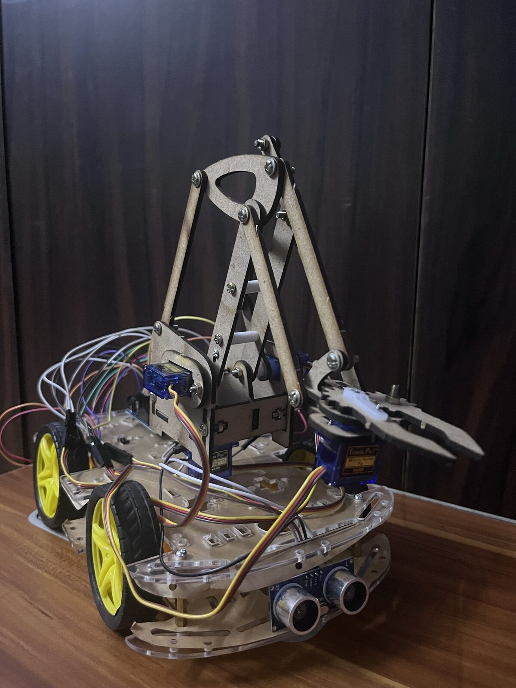
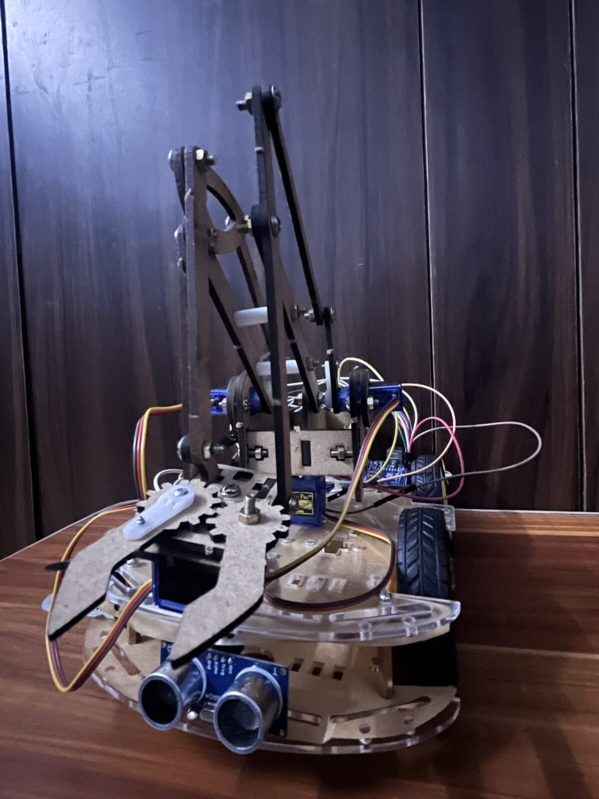
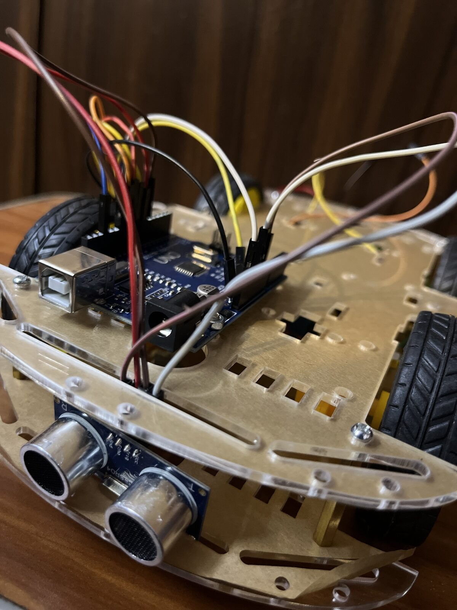
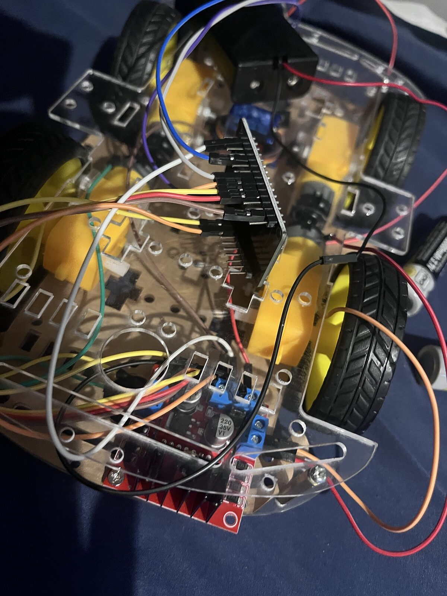

# Obstacle-Avoiding Robot with Pick-and-Place Arm

A four-wheel robot car that avoids obstacles on its own and carries a servo-driven arm for picking up and placing objects.

## Hardware
- **Controller:** Arduino UNO.
- **Obstacle detection:** HC-SR04 ultrasonic sensor.
- **Drive:** an L298N motor driver runs four DC gear motors.
- **Arm:** an MDF arm with a gripper, moved by SG90 micro servos.
- **Chassis:** two-layer acrylic.

| Side view | Wiring | Motor driver |
|---|---|---|
|  |  |  |
